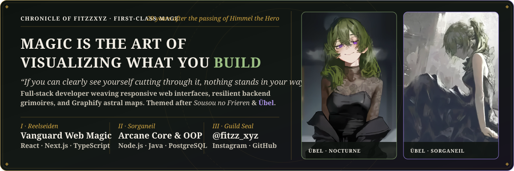
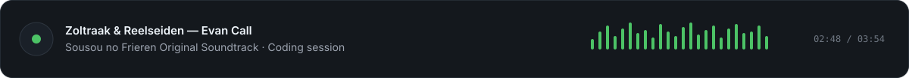
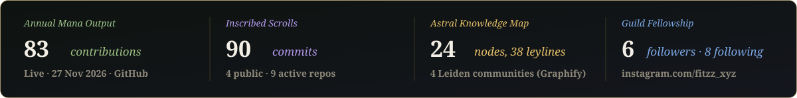
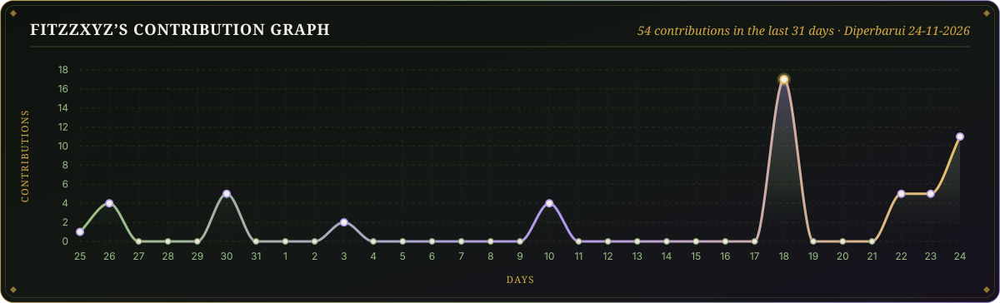

  <!-- ====================================================================== -->
  <!-- ACT I · ILLUMINATED GRIMOIRE HERO, CELESTIAL HOROLOGIUM & EXPEDITION  -->
  <!-- ====================================================================== -->

  <!-- HERO STAGE (Übel Nocturne & Sorganeil 4x HD Diptych + Animated Astrolabe) -->
  

    
  

  <!-- LIVE REAL-TIME GUILD BADGES -->
  

    &nbsp;
    &nbsp;
    &nbsp;
    &nbsp;
    
  

  <!-- ASTRAL HOROLOGIUM — LIVE WIB CELESTIAL CLOCK & IMPERIAL ERA REGISTRY -->
  <!-- Tip: Deploy repo ini ke Vercel lalu ganti src ke https://<app-anda>.vercel.app/api/clock?tz=Asia/Jakarta untuk jam real-time presisi tiap detik -->
  

    
  

  <!-- BARDIC RESONANCE & TAVERN GRAMOPHONE OST PLAYER -->
  

    
  

  <!-- CARTOGRAPHIC ROUTE: THE ROAD TO AUREOLE -->
  

    
  

  <!-- CHRONICLE I: THE ART OF VISUALIZATION & FIRST-CLASS MAGE EXAM -->
  

    
    
  

  

    
  

  <!-- ====================================================================== -->
  <!-- ACT II · FIRST-CLASS STATUS, COLLECTED GRIMOIRES, RELICS & QUEST LOG  -->
  <!-- ====================================================================== -->

  <!-- FIRST-CLASS MAGE & ADVENTURER ATTRIBUTES SHEET (Live Synced + Photo #1) -->
  

    
  

  <!-- COLLECTED GRIMOIRES & FOLK SPELLCRAFT COMPENDIUM -->
  

    
  

  <!-- CHRONICLE II: REELSEIDEN & THE TAILOR'S SHEARS -->
  

    
    
  

  <!-- EQUIPPED MAGE RELICS & ARCANE ARTIFACTS (Full-Stack Arsenal) -->
  

    
  

  <!-- THE MAGE'S STUDY WORKBENCH & LIVE LATEST QUEST (With Photo #2) -->
  

    
  

  

    
  

  <!-- ====================================================================== -->
  <!-- ACT III · LIVE TELEMETRY, VERIFIED LOC, CONTRIBUTION CURVE & GRAPHIFY -->
  <!-- ====================================================================== -->

  <!-- IMPERIAL ARCHIVE TELEMETRY LEDGER (Live Synced) -->
  

    
  

  <!-- TOTAL KODE YANG SUDAH SAYA TULIS (Auto-Updated on Every Commit & Hourly) -->
  

    
  

  <!-- ASTRAL MANA RESONANCE — 52-WEEK LIVE CONTRIBUTION CALENDAR -->
  

    
  

  <!-- FITZZXYZ'S 31-DAY LIVE CONTRIBUTION ACTIVITY GRAPH -->
  

    
  

  <!-- ASTRAL KNOWLEDGE CONSTELLATION — GRAPHIFY -->
  

    
  

  <!-- NOCTURNE & EMPATHY — ANIMATED CODA -->
  

    
    
  

  <!-- COLOPHON & CONTINENTAL SEAL -->
  

    
  

