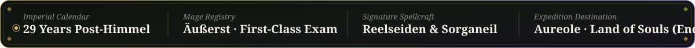
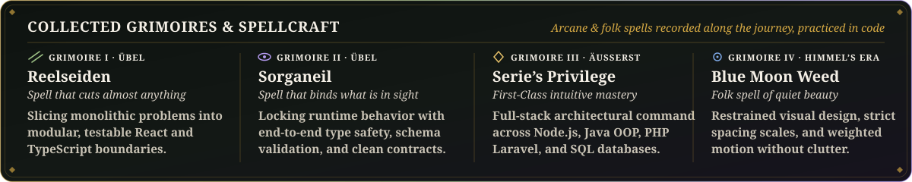
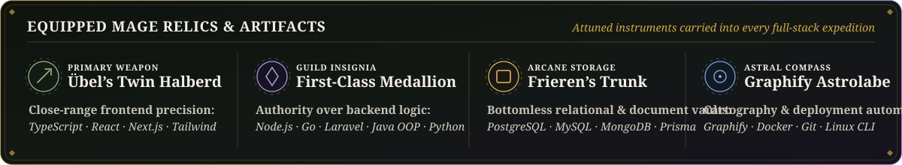

  <!-- I. ILLUMINATED GRIMOIRE HERO STAGE (Übel Nocturne & Sorganeil 4x HD Diptych) -->
  

    
  

  <!-- CONTINENTAL MAGIC ASSOCIATION LINKS & BADGES -->
  

    &nbsp;
    &nbsp;
    &nbsp;
    
  

  <!-- II. IMPERIAL CALENDAR & ASTROLABE ERA REGISTRY -->
  

    
  

  <!-- III. BARDIC RESONANCE & TAVERN GRAMOPHONE OST PLAYER -->
  

    
  

  <!-- IV. CARTOGRAPHIC ROUTE: THE ROAD TO AUREOLE -->
  

    
  

  <!-- V. CHRONICLE I: THE ART OF VISUALIZATION & FIRST-CLASS MAGE EXAM -->
  

    
    
  

  <!-- VI. FIRST-CLASS MAGE & ADVENTURER ATTRIBUTES SHEET (With Photo #1 Cutout) -->
  

    
  

  <!-- VII. COLLECTED GRIMOIRES & FOLK SPELLCRAFT COMPENDIUM -->
  

    
  

  <!-- VIII. CHRONICLE II: REELSEIDEN & THE TAILOR'S SHEARS -->
  

    
    
  

  <!-- IX. EQUIPPED MAGE RELICS & ARCANE ARTIFACTS -->
  

    
  

  <!-- X. THE MAGE'S STUDY WORKBENCH & QUEST BOARD (With Photo #2 Cutout) -->
  

    
  

  <!-- XI. THE ADVENTURER'S PARTY — FULL-STACK EXPEDITION ROLES -->
  

    
  

  <!-- EQUIPPED ARCANE RUNES & TOOLING -->
  

    
  

  <!-- XII. IMPERIAL ARCHIVE TELEMETRY LEDGER -->
  

    
  

  <!-- XIII. TOTAL KODE YANG SUDAH SAYA TULIS (DAILY AUTO-UPDATED LOC BREAKDOWN) -->
  

    
  

  

    Dihitung dari semua repo milik sendiri (termasuk private, tanpa fork), kode aktual tanpa baris kosong &amp; komentar. Diperbarui otomatis tiap hari.
  

  <!-- XIV. ASTRAL MANA RESONANCE — 52-WEEK SPELLCASTING CHRONICLE -->
  

    
  

  <!-- XIV. ASTRAL KNOWLEDGE CONSTELLATION — GRAPHIFY -->
  

    
  

  <!-- XV. NOCTURNE & EMPATHY — ANIMATED CODA -->
  

    
    
  

  <!-- XVI. COLOPHON & CONTINENTAL SEAL -->
  

    
  

