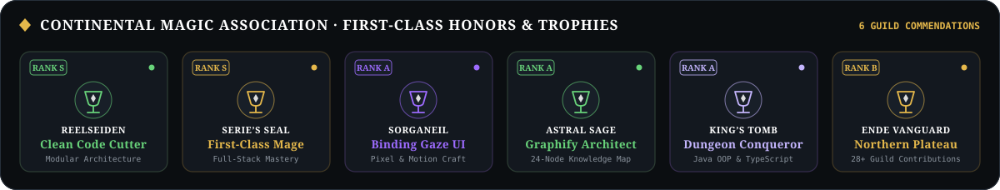
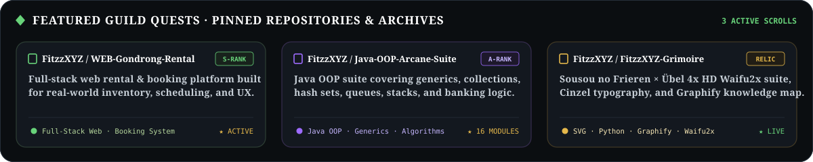
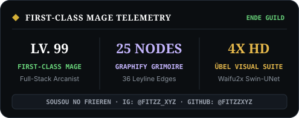
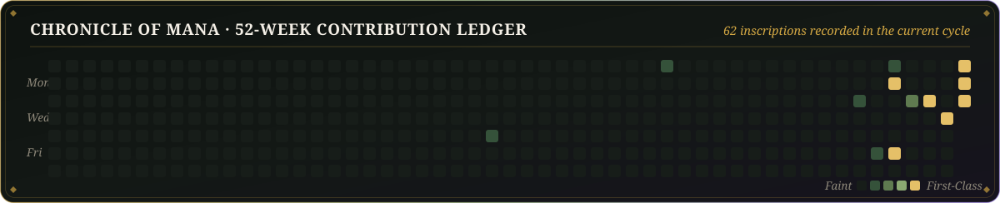
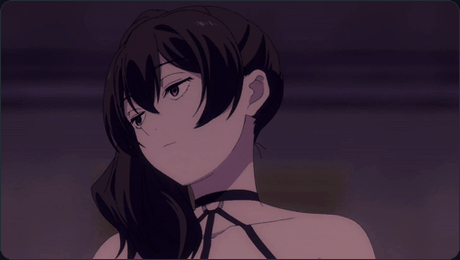

  <!-- ✦ 00 · ADVENTURER GUILD & FIRST-CLASS MAGE HERO STAGE (PHOTOS #3 & #4) ✦ -->
  

    
  

  <!-- ✦ ANIMATED GRIMOIRE TYPING SUBTITLE ✦ -->
  

    
  

  <!-- ✦ SINGLE-ROW GUILD REGISTRY & NAVIGATION BADGES ✦ -->
  

    &nbsp;
    &nbsp;
    &nbsp;
    
  

  <!-- ✦ WIDGET · ANIMATED SOUSOU NO FRIEREN OST & STUDY AMBIENCE PLAYER ✦ -->
  

    
  

  <!-- ✦ LORE ACT I · PHILOSOPHY OF VISUALIZATION + LIVE FOREST MANA GIF (460x259 MATCHED) ✦ -->
  

    
    
  

  <!-- ✦ 01 · RPG ADVENTURER & FIRST-CLASS MAGE ATTRIBUTES CARD (PHOTO #1 SPOTLIGHT) ✦ -->
  

    
  

  <!-- ✦ WIDGET · CONTINENTAL MAGIC ASSOCIATION FIRST-CLASS HONORS & TROPHIES ✦ -->
  

    
  

  <!-- ✦ LORE ACT II · TAILOR'S SCISSORS GIF + REELSEIDEN ARCHITECTURE PRINCIPLES (460x259 MATCHED) ✦ -->
  

    
    
  

  <!-- ✦ 02 · MAGE'S GRIMOIRE & ACTIVE GUILD QUESTS (PHOTO #2 SPOTLIGHT) ✦ -->
  

    
  

  <!-- ✦ WIDGET · FEATURED GUILD QUESTS & PINNED REPOSITORY SCROLLS ✦ -->
  

    
  

  <!-- ✦ 03 · ARCANE SPELLBOOK & FULL-STACK ARSENAL ✦ -->
  

    
  

  

    
  

  <!-- ✦ 04 · GRAPHIFY ASTRAL KNOWLEDGE MAP ✦ -->
  

    
  

  <!-- ✦ 05 · ADVENTURER GUILD TELEMETRY & MANA FLOW ✦ -->
  

    
  

  

    
    
  

  <!-- ✦ WIDGET · 52-WEEK MANA CONTRIBUTION MATRIX & ANIMATED REELSEIDEN TRAIL ✦ -->
  

    
  

  

    
  

  <!-- ✦ CLOSING DUAL LIVE ANIMATED GIF FINALE (460x260 SYMMETRICAL PAIR) ✦ -->
  

    
    
  

  

    
  

