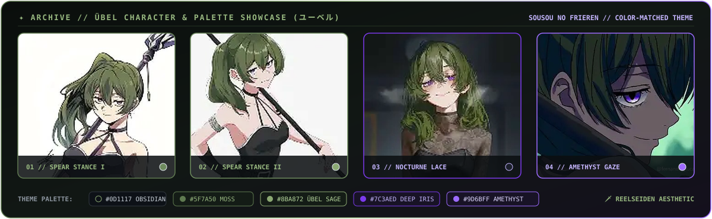

<div align="center">

  <!-- ✦ ARCHITECTURAL HERO STAGE (4X HD ANIME4K / WAIFU2X SWIN-UNET EDITION) ✦ -->
  

  <br /><br />

  <!-- ✦ PRIMARY NAVIGATION & SOCIAL BAR ✦ -->
  <p align="center">
    <a href="https://www.instagram.com/fitzz_xyz/" target="_blank">
      
    </a>
    &nbsp;
    <a href="https://github.com/FitzzXYZ?tab=repositories" target="_blank">
      
    </a>
    &nbsp;
    
    &nbsp;
    
  </p>

</div>


## `01 · Developer Workbench & Bento Dashboard`

<div align="center">
  
</div>

<br />

```ts
// fitzz.config.ts — Architectural Blueprint & Engineering Profile
export const developerProfile = {
  handle: "FitzzXYZ",
  role: "Full Stack Developer",
  designSystem: {
    theme: "Übel · Sousou no Frieren",
    surfaces: ["#0D0F0D", "#181818", "#1F1F1F", "#272727"],
    accents: { sage: "#8BA872", moss: "#5F7A50", amethyst: "#9D6BFF", iris: "#7C3AED" },
    typography: ["Geist", "Manrope", "Geist Mono"],
  },
  coreDomains: [
    "Full Stack Web Applications (React, Next.js, TypeScript, Tailwind CSS)",
    "Backend & Object Oriented Systems (Node.js, Java OOP, Python, PHP/Laravel)",
    "Relational & Document Databases (PostgreSQL, MySQL, MongoDB)",
  ],
  contact: {
    instagram: "https://www.instagram.com/fitzz_xyz/",
    github: "https://github.com/FitzzXYZ",
  },
} as const;
```


## `02 · Technical Stack & Engineering Matrix`

<div align="center">

| Interface & Motion | Backend & Core Logic | Data & Persistence | DevOps & Workflow |
| :--- | :--- | :--- | :--- |
|  |  |  |  |
|  |  |  |  |
|  |  |  |  |
|  |  |  |  |
|  |  |  |  |

<br />

<p align="center">
  
</p>

</div>


## `03 · Übel Visual Archive (4x HD Neural Remaster)`

<div align="center">
  
</div>


## `04 · Telemetry & GitHub Activity Dashboard`

<div align="center">

  <table>
    <tr>
      <td align="center" width="50%">
        
      </td>
      <td align="center" width="50%">
        
      </td>
    </tr>
    <tr>
      <td colspan="2" align="center">
        
      </td>
    </tr>
  </table>

  <br />

  

</div>
