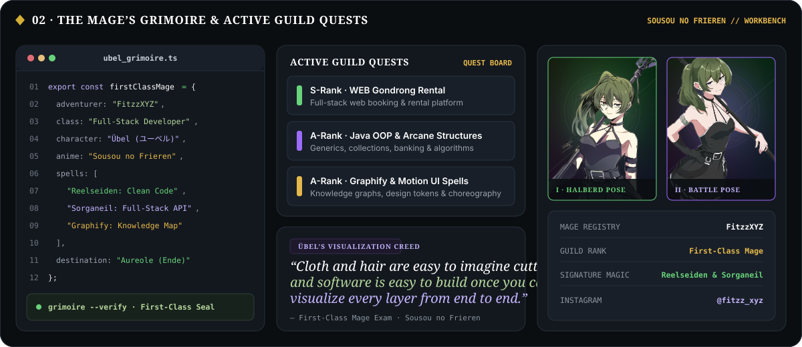

<div align="center">

  <!-- ✦ HERO BANNER (COLOR-MATCHED ÜBEL THEME) ✦ -->
  

  <br />

  <!-- ✦ ANIMATED TYPING HEADER ✦ -->
  <a href="https://github.com/FitzzXYZ">
    
  </a>

  <br />

  <!-- ✦ SOCIAL & IDENTITY BADGES ✦ -->
  <p align="center">
    <a href="https://www.instagram.com/fitzz_xyz/" target="_blank">
      
    </a>
    <a href="https://github.com/FitzzXYZ" target="_blank">
      
    </a>
    
    
  </p>

</div>


## 🗡️ `01 // THE MAGE'S GRIMOIRE`



> *"Magic is a world of visualization. If you can clearly see yourself cutting through it, nothing stands in your way."* — **Übel (ユーベル)**

Hey there! I'm **FitzzXYZ**, a passionate **Full-Stack Developer** who approaches software engineering the way a First-Class Mage approaches spellcasting: **through clear visualization, sharp precision, and intuitive execution**.

- 🔮 **Full-Stack Craftsmanship** — Designing responsive, high-impact interfaces paired with clean, resilient backend architectures.
- 🗡️ **Reelseiden Problem-Solving** — Breaking down complex systems into simple, maintainable, and razor-sharp code.
- 🌱 **Continuous Evolution** — Constantly experimenting with modern web frameworks, API architectures, and interactive UI/UX.
- 📸 **Connect with Me** — Follow my journey and reach out on **[Instagram (@fitzz_xyz)](https://www.instagram.com/fitzz_xyz/)**.

```ts
// ✦ fitzz_ubel.ts — Full-Stack Developer Configuration
const FitzzXYZ = {
  designation: "FitzzXYZ",
  role: "Full-Stack Developer",
  theme: "Übel // Sousou no Frieren (ユーベル)",
  signatureSpell: "Reelseiden (大体なんでも切る魔法)",
  focus: ["Full-Stack Web Apps", "Scalable APIs", "Interactive UI/UX", "Clean Architecture"],
  socials: {
    instagram: "https://www.instagram.com/fitzz_xyz/",
    github: "https://github.com/FitzzXYZ",
  },
  visualizeAndBuild(idea: string): string {
    return `⚡ Visualized '${idea}' -> Cut through the complexity -> Shipped to production.`;
  },
};
```

<br clear="right" />


## 🔮 `02 // SPELLBOOK & FULL-STACK ARSENAL`

<div align="center">

### ⚡ Frontend & UI Visualization
<p align="center">
  
  
  
  
  
  
  
</p>

### 🗡️ Backend, APIs & Core Systems
<p align="center">
  
  
  
  
  
  
</p>

### 🛡️ Databases, Cloud & DevOps
<p align="center">
  
  
  
  
  
  
</p>

<br />

<!-- ✦ SKILL ICONS VISUAL STRIP ✦ -->
<p align="center">
  
</p>

</div>


## 🌿 `03 // ÜBEL VISUAL ARCHIVE & PALETTE`

<div align="center">
  
</div>


## 📊 `04 // COMBAT TELEMETRY & GITHUB STATS`

<div align="center">

  <!-- ✦ COLOR-MATCHED STREAK & STATS CARDS ✦ -->
  <p align="center">
    
    
  </p>

  <!-- ✦ COLOR-MATCHED ACTIVITY GRAPH ✦ -->
  <p align="center">
    
  </p>

</div>


<div align="center">

  <!-- ✦ CONNECT CALLOUT ✦ -->
  <p align="center">
    <a href="https://www.instagram.com/fitzz_xyz/" target="_blank">
      
    </a>
    &nbsp;&nbsp;
    <a href="https://github.com/FitzzXYZ?tab=repositories" target="_blank">
      
    </a>
  </p>

  <!-- ✦ FOOTER BANNER ✦ -->
  

</div>
