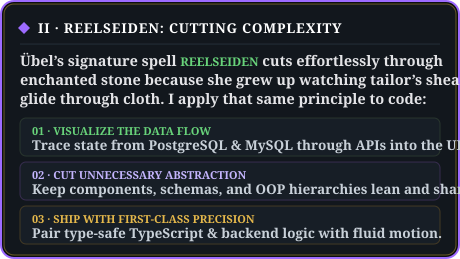

  

    
  

  

    &nbsp;
    &nbsp;
    
  

  

    
  

  

    
    
  

  

    
  

  

    
    
  

  

    
  

  

    
  

  

    
  

  

    
  

  

    
  

  

    
    
  

  

    
  

