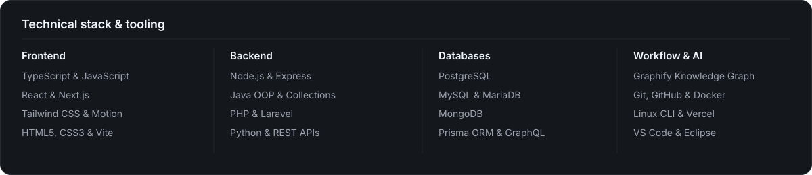

  <!-- ✦ 00 · ADVENTURER GUILD HERO STAGE ✦ -->
  

    
  

  <!-- ✦ GUILD REGISTRY & SOCIAL BADGES ✦ -->
  

    
    &nbsp;
    
    &nbsp;
    
    &nbsp;
    
  

  <!-- ✦ 01 · RPG ADVENTURER ATTRIBUTES & FIRST-CLASS MAGE STATUS SHEET ✦ -->
  

    
  

  <!-- ✦ 02 · MAGE'S GRIMOIRE & ACTIVE GUILD QUESTS ✦ -->
  

    
  

  <!-- ✦ 03 · ARCANE SPELLBOOK & FULL-STACK ARSENAL ✦ -->
  

    
  

  

    
  

  <!-- ✦ 04 · ÜBEL 4X HD VISUAL ARCHIVE ✦ -->
  

    
  

  <!-- ✦ 05 · GRAPHIFY ASTRAL KNOWLEDGE MAP ✦ -->
  

    
  

  <!-- ✦ 06 · ADVENTURER GUILD TELEMETRY & MANA FLOW ✦ -->
  

    
  

  

    
    
  

  

    
  

  

    
  

